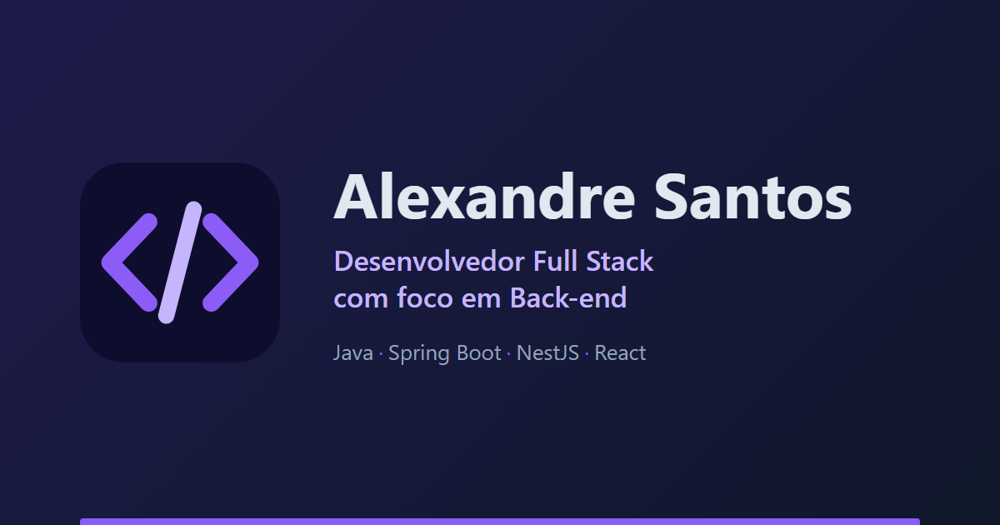

# Portfólio Web



Site pessoal de Alexandre Santos, desenvolvedor Full Stack com foco em Back-end. Reúne quem eu sou, minhas habilidades e os projetos que estão no meu GitHub.

**No ar:** https://portifolio-web-alexsantos.vercel.app

## Tecnologias

- [React 19](https://react.dev) com componentes funcionais e hooks
- [Vite 8](https://vite.dev) para desenvolvimento e build
- CSS puro, sem framework
- Ícones do [Font Awesome](https://fontawesome.com) e do [Devicon](https://devicon.dev)
- Deploy na [Vercel](https://vercel.com)

## Como rodar

Precisa do [Node.js](https://nodejs.org) 20.19 ou mais recente (ou 22.12+), que é o mínimo do Vite 8.

```bash
npm install       # instala as dependências
npm run dev       # servidor de desenvolvimento em http://localhost:5173
npm run build     # gera o site final em dist/
npm run preview   # serve o dist/ em http://localhost:4173
```

## Estrutura

```
public/                 arquivos servidos como estão
├── assets/             imagens do perfil e dos projetos
├── favicon.svg         ícone da aba
└── og-image.png        imagem da prévia do link (Open Graph)
src/
├── components/         um componente por seção do site
├── data/               conteúdo: projetos, habilidades, links e ícones
├── hooks/              useReveal (animação ao rolar) e useTypewriter (digitação do título)
├── utils/              rolagem suave e contador de visitas
├── styles/style.css    estilo do site inteiro
├── App.jsx             monta as seções na ordem
└── main.jsx            ponto de entrada
index.html              <head> com ícones, favicon e tags Open Graph
vercel.json             diz à Vercel que o projeto é Vite e sai em dist/
```

## Como atualizar o conteúdo

O conteúdo fica separado dos componentes, em `src/data/`. Na maior parte das vezes, basta mexer ali.

- **Projeto novo**: adicione um objeto em `src/data/projects.js`, com título, imagem, descrição, tecnologias e links. A imagem vai em `public/assets/`.
- **Habilidade nova**: adicione o nome em `src/data/skills.js`.
- **Ícone de uma tecnologia**: fica em `src/data/techIcons.js`, usado pelas habilidades e pelas tags dos projetos. Tecnologia que não estiver no mapa aparece só com o nome.
- **Menu, redes sociais e contato**: em `src/data/site.js`.

## Deploy

A Vercel publica sozinha a cada push:

- `dev`: gera um Preview, para testar as mudanças antes de irem para o ar.
- `main`: atualiza o site oficial. As mudanças chegam pela `dev`, por pull request.

As tags Open Graph do `index.html` apontam para o endereço oficial. Depois de mudar a imagem ou os textos da prévia, cole o link no [Post Inspector do LinkedIn](https://www.linkedin.com/post-inspector/) para ele ler de novo.

## Contato

- [LinkedIn](https://www.linkedin.com/in/alexandre-santana-santos)
- [GitHub](https://github.com/alexsant22)
